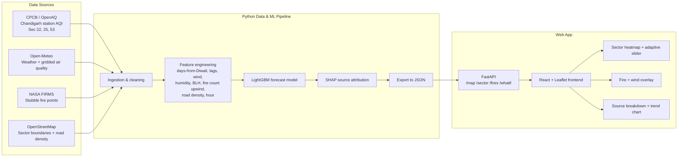

# DhuaanMap 🌫️
### Sector-level Diwali air pollution forecasting for Chandigarh, with stubble-burning attribution

> **RootAccess 2026 · Paryavaran Welfare Society, TIET Patiala**
> Problem Statement: *AI-Powered Neighborhood-Level Air Pollution Prediction System*

---

## The Problem
Every year around Diwali, air quality in Chandigarh drops sharply. Two sources hit at the same time:
- **Firecrackers** inside the city on Diwali night
- **Stubble burning** in the farm fields of Punjab and Haryana, whose smoke is carried into the city by wind

Existing AQI apps show one city-wide number. They don't tell you **which sector** is worst, **when** it will peak, or **why**: crackers, stubble, traffic or weather.

## Our Solution
DhuaanMap is an interactive map of Chandigarh that shows **sector-by-sector AQI from 5 days before to 5 days after Diwali**, controlled by an **adaptive time slider**. It overlays **live stubble-fire locations and wind direction**, so users can see smoke moving from the fields into the city. An ML model forecasts AQI and explains how much each source contributes.

## What Makes Us Different
1. **Stubble-burning overlay.** NASA FIRMS fire points and wind arrows on the same map as city AQI.
2. **Source attribution.** Each prediction is split into Crackers / Stubble / Traffic / Weather using SHAP.
3. **Adaptive slider.** Moves day by day across ±5 days, and hour by hour on Diwali night when AQI spikes.
4. **Past vs Forecast.** Real data from Diwali 2025 (20 Oct) next to our forecast for Diwali 2026 (8 Nov).
5. **True neighborhood level.** Chandigarh's sector layout lets us color each sector individually.

---

## Feature Scope

### ✅ MVP (must work for the final demo)
| # | Feature | Description |
|---|---|---|
| F1 | Sector map | Leaflet map of Chandigarh, each sector colored by AQI category |
| F2 | Adaptive time slider | Day −5 → Day +5; hourly steps on Diwali night (6 PM – 6 AM) |
| F3 | Stubble fire overlay | Fire points (NASA FIRMS) within ~200 km, filtered per day |
| F4 | Wind arrows | Wind direction and speed for the selected time |
| F5 | Source breakdown panel | Crackers / Stubble / Traffic / Weather share for the selected sector and time |
| F6 | Past vs Forecast toggle | Diwali 2025 (actual) vs Diwali 2026 (predicted) |
| F7 | AQI trend chart | Line chart of the selected sector across the ±5-day window, with Diwali marked |

### ❌ Out of scope (tonight)
Real-time traffic feeds, user accounts, mobile app, cities other than Chandigarh, IoT sensors.

---

## System Architecture



### How it works
1. **Ingestion:** Pull station AQI, weather, fire points and sector geometry for the ±5-day windows of Diwali 2025 and Diwali 2026.
2. **Features:**
   - Lagged AQI (1h, 6h, 24h)
   - Days and hours from Diwali
   - Wind speed and direction, humidity, temperature, boundary layer height
   - **Upwind fire count:** fires in the direction the wind is coming from
   - Road density for each sector
   - Hour of day
3. **Model:** LightGBM regression predicts PM2.5 for each sector and hour. Station readings are spread to all sectors using Open-Meteo gridded values and spatial interpolation.
4. **Attribution:** SHAP values are grouped into 4 buckets:
   - **Crackers:** Diwali-timing features
   - **Stubble:** fire features
   - **Traffic:** road density and hour
   - **Weather:** meteorological features
5. **Serving:** Predictions are pre-computed into JSON so the demo is fast and doesn't depend on Wi-Fi. FastAPI serves them, and the frontend falls back to static JSON if the API is down.

---

## Tech Stack
| Layer | Tools |
|---|---|
| Frontend | React (Vite), TypeScript, Tailwind, Leaflet / react-leaflet, Recharts |
| Backend | Python, FastAPI |
| ML / Data | Pandas, LightGBM, SHAP, scikit-learn |
| Data | CPCB/OpenAQ, Open-Meteo, NASA FIRMS, OpenStreetMap |
| Tools | GitHub, bolt.new (UI scaffold), Cursor |

---

## Data Contract (frontend ⇄ backend)
`GET /map?mode=past|forecast&t=<ISO time>`
```json
{
  "time": "2025-10-20T22:00:00+05:30",
  "day_offset": 0,
  "sectors": [
    { "id": "S17", "name": "Sector 17", "aqi": 342, "pm25": 210.5, "category": "Very Poor",
      "sources": { "crackers": 0.42, "stubble": 0.33, "traffic": 0.15, "weather": 0.10 } }
  ],
  "fires": [ { "lat": 30.41, "lon": 76.12, "frp": 12.4 } ],
  "wind": { "speed_kmh": 4.2, "direction_deg": 300 }
}
```

---

## Project Structure
```
dhuaanmap/
├── data/
│   ├── sectors.json          # Chandigarh sector points (run scripts/geocode_sectors.py to refresh)
│   ├── raw/                  # downloaded CSVs (aq, weather, fires)
│   └── processed/            # past.json + forecast.json served to the app
├── model/
│   ├── fetch_data.py         # Open-Meteo + NASA FIRMS download
│   └── train.py              # features → LightGBM → SHAP → JSON export
├── backend/main.py           # FastAPI (serves mock data until model output exists)
├── frontend/                 # React + Leaflet app (bolt.new scaffold)
├── scripts/geocode_sectors.py
├── docs/                     # SOW, architecture.mermaid, bolt prompt, pitch deck
└── README.md
```

## Run Locally
```bash
# 1. Backend (works immediately with mock data)
cd backend && pip install -r requirements.txt && uvicorn main:app --reload
# → http://127.0.0.1:8000/docs

# 2. Data + model (from repo root)
pip install -r model/requirements.txt
python scripts/geocode_sectors.py                    # real sector coordinates
FIRMS_MAP_KEY=your_key python model/fetch_data.py    # download data
python model/train.py                                # train + export JSON
# restart the backend → it now serves real predictions

# 3. Frontend
cd frontend && npm install && npm run dev
```

### API
| Endpoint | Purpose |
|---|---|
| `GET /health` | Status, and whether data is mock or real |
| `GET /timeline?mode=past\|forecast` | All time steps (builds the adaptive slider) |
| `GET /map?mode=&t=` | Sector AQI + sources, fires, wind at a time |
| `GET /sector/{id}?mode=` | One sector's AQI across the ±5-day window |
| `GET /whatif?cracker_cut=0.5&stubble_cut=0.3` | Stretch: simulate reductions |

## Team
| Name | Role |
|---|---|
| _Name_ | Team Lead · Docs · Pitch |
| _Name_ | ML & Data |
| _Name_ | Backend |
| _Name_ | Frontend |

## Hackathon Roadmap
| Round | Time | Deliverable |
|---|---|---|
| 1 · Ideation & Setup | 1:30 – 2:30 AM | Architecture, README, repo with skeleton |
| 2 · MVP & Pitch Draft | 6:00 – 7:00 AM | Working build + 3–4 slide deck |
| 3 · Grand Finale | 8:00 – 9:00 AM | 3-min pitch + end-to-end demo |
